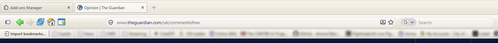
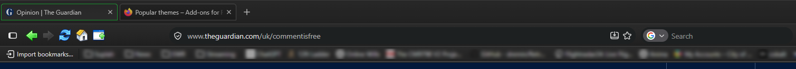

# RetroFox 2004

> Bringing the personality of Firefox 2004 back to the modern web.

RetroFox 2004 is a cosmetic theme for modern Firefox that recreates the look and feel of Mozilla Firefox 1.0 (released November 2004). It uses genuine Winstripe artwork extracted from the original Firefox 1.0 `classic.jar`, applied through Firefox's `userChrome.css` system.

No Firefox downgrade is required. Your browser stays fully updated and secure.

## Design

Firefox 1.0's interface was warm, colourful and skeuomorphic: bright green Back/Forward arrows, a blue Reload button, a red Stop button, grey toolbars and rectangular address bars. RetroFox 2004 brings that character to current Firefox, in both a faithful **Classic (light)** edition and a **Dark** edition that imagines an official 2004 dark mode.

## Features

### Classic Edition
- Genuine Mozilla Winstripe icons (green Back/Forward, blue Reload, red Stop, colourful Home and more)
- Classic grey/cream Windows XP-style toolbars
- Traditional menu bar (File, Edit, View, History, Bookmarks, Tools, Help)
- Rectangular address bar
- Firefox 1.0-style tabs and toolbar spacing
- Original colourful toolbar icons at native 24x24 pixels

### Dark Edition
- Dark charcoal/graphite toolbars with subtle gradients
- Dark tabs, address bar and bookmarks toolbar
- Raised button hover and pressed effects
- Retains every original colourful Winstripe icon unchanged
- Readable text and good contrast throughout

## Screenshots

### ☀️ Classic Edition

The original Firefox 2004 experience, featuring authentic
Winstripe icons and classic silver toolbars.



### 🌙 Dark Edition

A modern dark interpretation of the original Firefox 1.0
interface, retaining its colourful icons and personality.



## Installation (Windows)

1. Download or clone this repository.
2. Open Firefox and go to `about:support`.
3. Beside "Profile Folder", click "Open Folder".
4. Completely exit Firefox.
5. In your profile folder, open or create a folder named `chrome` (all lowercase).
6. Copy the entire `chrome/RetroFox2004` folder into your profile's `chrome` folder.
7. Copy `chrome/userChrome.css` into your profile's `chrome` folder.
   - If you already have a `userChrome.css`, keep it and add this line at the very top:
     ```
     @import url("RetroFox2004/theme.css");
     ```
8. Reopen Firefox, visit `about:config`, accept the warning, and set
   `toolkit.legacyUserProfileCustomizations.stylesheets` to `true`.
9. Exit Firefox fully and reopen it once more.

Optional: right-click an empty part of the toolbar to enable the Menu Bar, and use "Customize Toolbar" to add Home if needed.

## Switching editions

```powershell
powershell -ExecutionPolicy Bypass -File "scripts\switch.ps1" -Mode Dark
powershell -ExecutionPolicy Bypass -File "scripts\switch.ps1" -Mode Light
```

Restart Firefox after switching (use `-purgecaches` if the change does not appear).

## Uninstallation

```powershell
powershell -ExecutionPolicy Bypass -File "scripts\remove.ps1"
```

Or manually remove the `chrome/RetroFox2004` folder and the `@import` line from `chrome/userChrome.css`. The installer backs up any existing `chrome/` folder before modifying it.

## Tested versions

- Mozilla Firefox 158.0.1 on Windows
- Requires `toolkit.legacyUserProfileCustomizations.stylesheets` enabled

## Compatibility notes

- Mozilla does not officially support `userChrome.css`; future Firefox updates may require selector updates.
- Some modern Firefox features are intentionally preserved and remain fully functional.
- The theme styles the browser interface only, not websites.

## Troubleshooting

- **Nothing changes:** confirm the pref is `true`, that `userChrome.css` is in the correct profile's `chrome` folder, then restart with `-purgecaches`.
- **Icons missing:** verify the `chrome/RetroFox2004/icons` folder was copied and that image paths are intact.
- **Partial styling:** a Firefox update may have changed selectors; check the project for updates.

## Credits

- Original Winstripe artwork by Stephen Horlander and Kevin Gerich (Mozilla), extracted from Firefox 1.0's `chrome/classic.jar`.
- RetroFox 2004 theme and tooling by the RetroFox 2004 project.

## Licensing

- Project code and scripts: MIT License (`LICENSE`).
- Original Mozilla Winstripe artwork: redistributed under the Mozilla tri-licence, MPL 1.1 / GPL 2.0 / LGPL 2.1, as released by Kevin Gerich and Stephen Horlander in July 2006 (`LICENSE-ORIGINAL.txt`). The artwork's original Firefox 1.0 files carried an NPL 1.1 / GPL 2.0 / LGPL 2.1 header, which is preserved in `LICENSE-ORIGINAL.txt`.
- The artwork is not relicensed under MIT.
- Mozilla and Firefox are trademarks of the Mozilla Foundation. This project is an independent community effort and is not affiliated with or endorsed by Mozilla.
